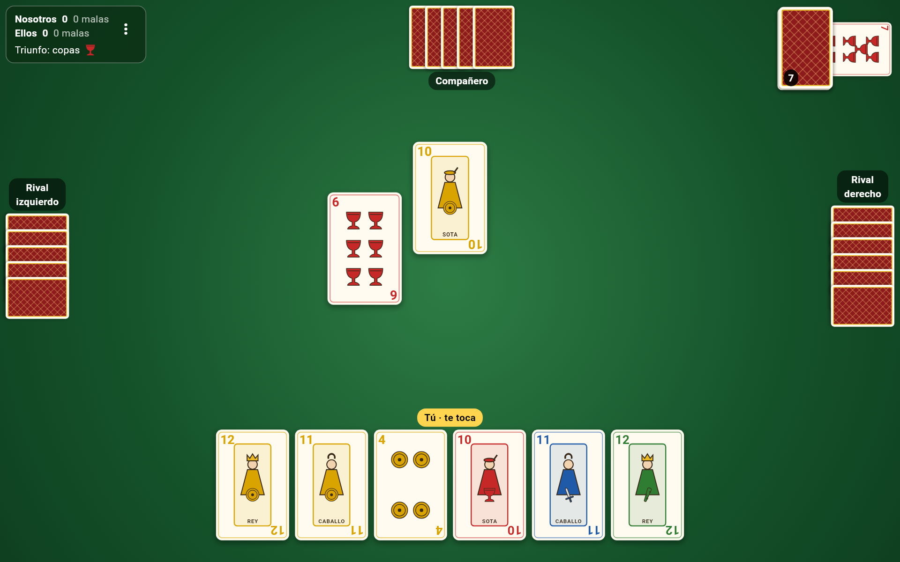
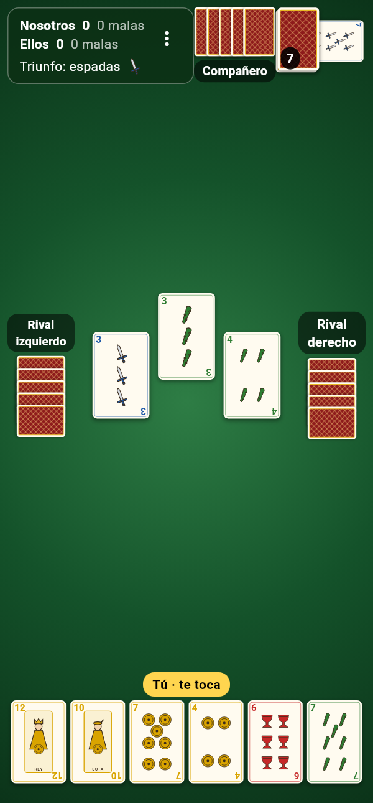
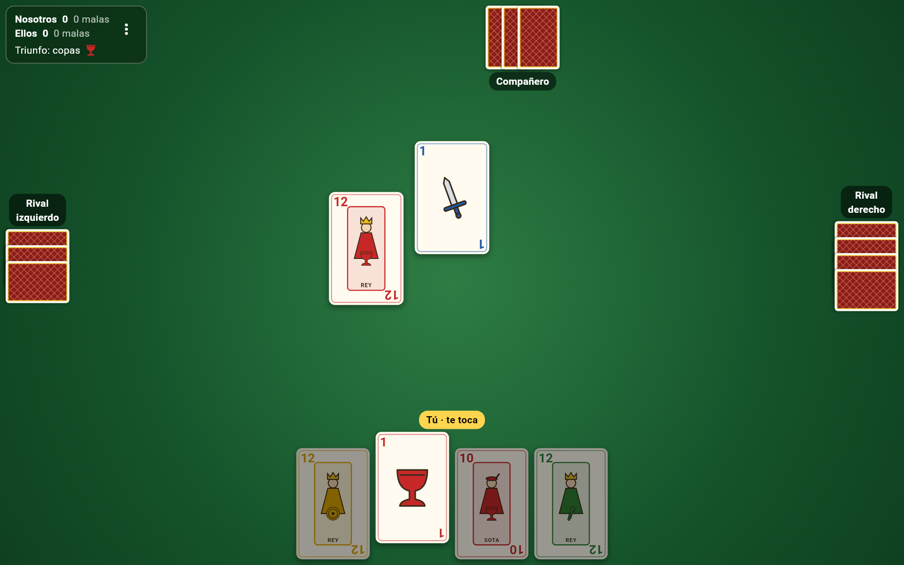

# Guiñote

El guiñote es el juego de cartas tradicional de Aragón y Valencia. Esta versión, hecha en Flutter para web y Android, te sienta a la mesa con un compañero contra dos rivales, y los tres los maneja el ordenador.



<p align="center">
  
  &nbsp;
  
</p>

## Qué incluye

- **Las reglas completas del guiñote aragonés**, especificadas en [REGLAS.md](REGLAS.md): reparto, robos, obligaciones del arrastre, cantes de 20 y 40, cambio del 7 de triunfo, diez de últimas, malas y buenas, y manos de vueltas.
- **Una IA para los otros tres jugadores.** Carga puntos a su compañero, mata con la carta más barata, guarda los triunfos y las parejas de rey y caballo, y en el arrastre cuenta las cartas. Gana más del 75 % de las partidas a jugadores aleatorios.
- **Una interfaz adaptable** a escritorio y móvil:
  - en tu turno solo se pueden echar las cartas legales;
  - los botones de cantar y de cambiar el 7 aparecen solo cuando se pueden usar;
  - la baza se recoge sola a los 3 segundos;
  - al acabar cada mano se muestra el recuento.
- **Cartas dibujadas por código** con `CustomPainter`: los cuatro palos, los números, las figuras y el dorso. No usa imágenes de terceros.

## Arquitectura

```
packages/guinote_core/   Dart puro, sin Flutter: reglas, estado, puntuación e IA
app/                     Flutter: pantalla, animaciones y controlador de partida
```

- **Las reglas, separadas de la interfaz.** `guinote_core` es un paquete Dart independiente y no puede importar Flutter. Sus tests corren con `dart test` en segundos.
- **Estado inmutable.** `EstadoMano` es inmutable y cada acción (`jugar`, `recoger`, `cantar`, `cambiarSiete`) devuelve un estado nuevo o lanza `AccionInvalida`. Así se puede repetir cualquier partida y probar cualquier situación.
- **Una sola fuente de verdad para las reglas.** La interfaz y la IA usan la misma función de jugadas legales, así que la interfaz no valida reglas por su cuenta.
- **Una IA que no hace trampas.** Solo recibe una `VistaJugador`, con su mano y lo que hay en la mesa. Las cartas de los demás y el orden del mazo no están a su alcance.
- **Azar controlado.** El `Random` se pasa con semilla, de modo que los tests y las capturas siempre salen iguales.
- **Un controlador pequeño.** `ControladorPartida` es un `ChangeNotifier` que conecta el motor con la pantalla: gestiona los turnos de la IA, los tiempos y los avisos. No usa librerías de gestión de estado.

| Archivo | Contenido |
|---|---|
| [`reglas.dart`](packages/guinote_core/lib/src/reglas.dart) | Ganador de la baza y obligaciones del arrastre, como funciones puras |
| [`estado_mano.dart`](packages/guinote_core/lib/src/estado_mano.dart) | Reparto, turnos, robos, cantes, cambio del 7 y recuento |
| [`partida.dart`](packages/guinote_core/lib/src/partida.dart) | Malas, buenas, vueltas y ganador |
| [`ia.dart`](packages/guinote_core/lib/src/ia.dart) | Estrategia heurística |
| [`controlador_partida.dart`](app/lib/src/juego/controlador_partida.dart) | Ritmo de la partida en pantalla |
| [`pintor_carta.dart`](app/lib/src/cartas/pintor_carta.dart) | Baraja española dibujada por código |

## Tests

```bash
cd packages/guinote_core && dart test     # 82 tests del motor y la IA
cd app && flutter test                    # 10 tests del controlador y la mesa
```

- **Reglas:** hay un test por cada regla. Cubren el orden y los puntos de las cartas, el ganador de la baza, cada obligación del arrastre (incluido el caso de no tener que matar a tu compañero), los cantes, el cambio del 7, los robos y la puntuación con vueltas.
- **Simulación:** se juegan 500 manos y 50 partidas al azar. En cada paso se comprueba que siempre hay alguna carta legal, que ninguna carta se pierde ni se duplica y que cada mano reparte 130 puntos más los cantes.
- **IA:** hay tests de jugadas concretas y una prueba de fuerza contra jugadores aleatorios.
- **Interfaz:** los tests usan temporizadores simulados. Comprueban que la baza se recoge a los 3 segundos, que el compañero espera si puedes cantar y que la IA no canta por ti.

La integración continua de GitHub Actions comprueba el formato, el análisis estático y los tests, y compila la web.

## Cómo ejecutarlo

Requisitos: Flutter 3.47 o posterior.

```bash
cd app
flutter pub get
flutter run -d chrome        # web
flutter run                  # Android, con un dispositivo o emulador
flutter build apk --release  # APK
```

Las capturas de este README se generan con un test que usa fuentes reales y tiempo simulado:

```bash
cd app && flutter test --dart-define=CAPTURAS=true test/capturas
```

## Próximos pasos

- Partidas en línea entre personas.
- Una IA más fuerte que intente adivinar qué cartas tienen los demás.
